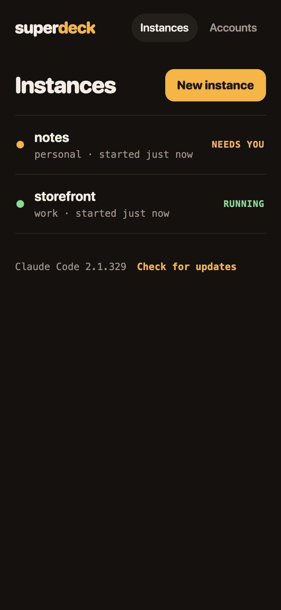
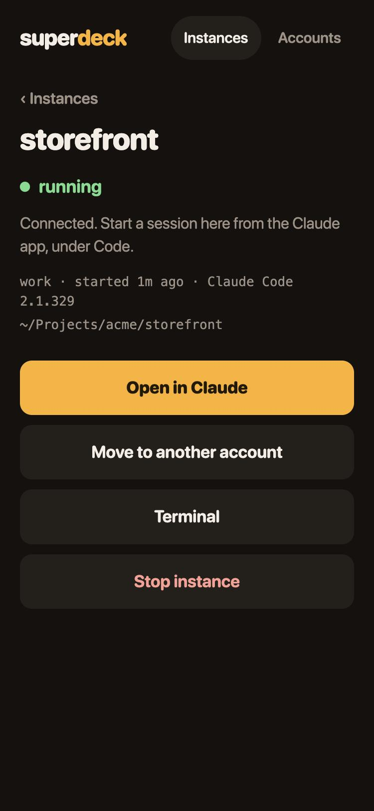
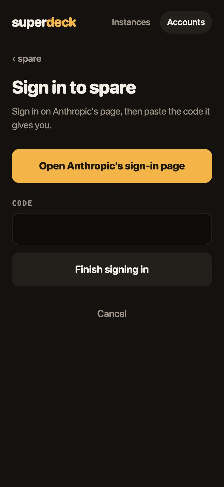

# Superdeck

Start Claude Code Remote Control instances on a Mac from your phone, under more than one Claude account.

Superdeck is a small web application served by one Go binary on your Mac. You open it, see what is running, and launch a new instance by picking an account and a folder. The Mac runs Anthropic's own `claude remote-control` in that folder, and you carry on the conversation in the official Claude app. Superdeck is a launcher, not a chat client.

**Status: early.** Signing in accounts, launching a connected instance, running under launchd and recovering from a crash have been run for real on macOS with Claude Code 2.1.296 to 2.1.329. A full session through the Claude app has not been tested yet. Superdeck has no sign-in of its own and serves plain HTTP.

<p>
  
  
  
</p>

## What it does

- **Instances.** The home screen lists what is running. Open one to see its state, answer anything Claude is asking, stop it or relaunch it.
- **New instance.** Pick an account and a folder: a Git repository, or a folder that holds several. In a repository, sessions started from the Claude app each get their own Git worktree. In a folder of repositories they share the folder.
- **Accounts.** Each account has its own Claude config directory (`CLAUDE_CONFIG_DIR`), so several can be signed in side by side. Adding one runs Anthropic's `claude auth login`: you open Anthropic's page, sign in, and paste the code back.
- **Questions.** When Claude asks something on first run, such as whether to trust a folder, Superdeck shows the question with buttons. A yes/no question it does not recognise is shown in Claude's own words.
- **Moving.** When one account runs out of usage, move an instance to another: it stops under the first account and launches in the same folder under the second. Files stay; the conversation does not carry over.
- **Staying up.** An instance that dies on its own is restarted with a growing delay. Instances you launched are remembered and brought back when Superdeck itself restarts.
- **Updates.** The home screen shows the installed Claude Code version and a "Check for updates" link that runs `claude update`. Nothing updates on its own. An instance still running an older version offers to relaunch.

<p>
  
  
  
</p>

The screenshots use sample data.

## How it is built

Everything is rendered on the server with Go's `html/template`. The only script in the browser is [htmx](https://htmx.org), one vendored file, which refreshes status fragments and filters the folder list. Every screen also works as plain links and forms.

Claude runs under a pseudo-terminal. Superdeck keeps a terminal emulator on the server for each process and shows its screen as escaped HTML in a collapsed "Output" section, for when you need to see what Claude printed.

Dependencies: [creack/pty](https://github.com/creack/pty) for the pseudo-terminal, [hinshun/vt10x](https://github.com/hinshun/vt10x) for terminal emulation, [modernc.org/sqlite](https://modernc.org/sqlite) (SQLite in pure Go, so the binary stays self-contained) and [pressly/goose](https://github.com/pressly/goose) for migrations. No Node, no build step for the front end.

## Run it

```bash
go build -o superdeck .
```

```bash
./superdeck ~/Projects
```

Open `http://127.0.0.1:7433`.

The folders you name are the only places Superdeck may launch Claude in, along with the folders inside them. Name as many as you like, or use glob patterns. Flags go before the folders.

```bash
./superdeck ~/Projects ~/clients/acme-*
```

To reach it from a phone on your LAN or home VPN, listen on the Mac's LAN address. There is no sign-in, so anything that can reach that address can use it; only do this on a network you trust.

```bash
./superdeck -addr 192.168.1.20:7433 ~/Projects
```

### Start at login

This prints a launchd agent for the settings you pass.

```bash
./superdeck -addr 192.168.1.20:7433 -launch-agent ~/Projects > ~/Library/LaunchAgents/com.github.bradgessler.superdeck.plist
```

```bash
launchctl bootstrap gui/$(id -u) ~/Library/LaunchAgents/com.github.bradgessler.superdeck.plist
```

launchd then restarts Superdeck if it exits, and Superdeck relaunches the instances it remembers. To remove it:

```bash
launchctl bootout gui/$(id -u)/com.github.bradgessler.superdeck
```

State lives in `~/.superdeck`: a SQLite database (`superdeck.db`) holding accounts and the instances to bring back, one Claude config directory per account, and a log.

### Upgrading

Replace the binary and start it. Schema changes are numbered SQL files in `migrations/`, compiled into the binary and applied on startup before anything is launched. Before changing existing data Superdeck writes a copy next to it, named `superdeck.db.before-schema-N`. If the data was written by a newer Superdeck than the one you are starting, it refuses to run rather than guess.

## Security model

Superdeck can start processes on your Mac. It has no sign-in. The model is: it can only do a short, fixed list of things, and you keep it reachable only from a private network.

The worst someone who reaches the page should be able to do is launch Claude instances in the folders you allowed, answer Claude's yes/no questions, start a sign-in, and stop, relaunch or move what is running.

- **Fixed commands.** It runs only `claude remote-control`, `claude auth login`, `claude auth status`, `claude update`, `claude --version` and `git init`, with arguments it builds itself and passes as a list, never through a shell.
- **No typing into Claude.** The page cannot send text to a process. It can answer yes or no, or press one of nine named keys (Enter, y, n, 1, 2, 3, Up, Down, Esc). The one exception is a sign-in, which accepts a single code made of letters, digits and `_.~#+/=-`.
- **Validated names.** Account names and new folder names are checked against strict patterns before they reach a command line.
- **Confined folders.** A folder must be one you named on the command line, or inside one, after symlinks are resolved.
- **Escaped output.** Everything a process prints is HTML-escaped before it is shown.
- **No cross-site driving.** Every request must carry an expected `Host` header and every state-changing request must be same-origin, so a web page elsewhere cannot drive Superdeck through your browser.
- **Clean environment.** Child processes get an explicit environment. The launcher's own `CLAUDE_*` and `ANTHROPIC_*` variables are not passed on.
- **No shortcuts around Claude's safeguards.** It never passes `--dangerously-skip-permissions` or a permission-mode override, and never edits Claude's config to pre-trust a folder. It never reads or stores Claude credentials.

Not built: sign-in, TLS.

## What happens when things go wrong

| Failure | What Superdeck does |
|---|---|
| Superdeck crashes or is killed | launchd restarts it. Its Claude processes die with it, and the instances you had launched are relaunched. Conversations they were hosting are interrupted. |
| A Claude instance dies on its own | Restarted after 5 seconds, doubling up to 5 minutes, at most 8 times in a row. |
| An instance fails within 30 seconds of starting | Left stopped and marked failed, with its output shown. Restarting would only loop. |
| An account is signed out | The instance stops and says so. It is not restarted. Right after the Mac starts, a signed-out report is retried three times first, in case the Keychain was not readable yet. |
| Claude asks a question | The instance waits and shows "needs you" until you answer. |
| You decline to trust a folder | The instance stops. It is not restarted. |
| A sign-in code is wrong or expired | The sign-in is marked failed with a "Try again" button. |
| A sign-in is abandoned | Cancelled after 15 minutes. Starting another returns you to the one in progress. |
| A process prints something the terminal emulator cannot handle | That process falls back to plain text output. Superdeck keeps running. |
| The Mac reboots with FileVault on | Nothing runs until someone unlocks the Mac in person. |

## Open questions

| # | Question | Status |
|---|----------|--------|
| 1 | Can an account be signed in through the page, with the code pasted back? | **Yes.** Done for two accounts. |
| 2 | Do two accounts stay separate? | **Yes for sign-in.** Each gets its own Keychain entry, keyed to its config directory's path. That is why an account's directory never moves. Running two instances at once under different accounts is untested. |
| 3 | Does it work when launchd starts it, including Keychain access? | **Yes.** |
| 4 | With a pseudo-terminal, do first-run prompts appear instead of the process exiting? | **Yes.** Folder trust asks `Trust <path>? [y/N]`; after answering, the instance connected with no further prompt. |
| 5 | Does each instance show up in the Claude app under the right account only? | **Open.** |
| 6 | After a network outage longer than ten minutes, when the server exits by design, does the restart bring it back cleanly? | **Open.** Restart logic is tested against a stand-in. |
| 7 | Does `claude update` behave when run from here? | **Open.** |
| 8 | Can instances survive a Superdeck restart instead of being relaunched? | **Open.** Not built. |
| 9 | Is passing a sign-in code through this page within Anthropic's terms for third-party tools? | **Open.** Superdeck hands the code straight to the official binary and stores nothing. Read the [terms](https://code.claude.com/docs/en/legal-and-compliance). |

On Team and Enterprise plans an owner has to turn Remote Control on before any of this works.

## Development

```bash
go test -race ./...
```

Tests run against a shell-script stand-in for the Claude CLI, so they need no account.

`CLAUDE.md` and the skills in `.claude/skills` hold the working rules for this project: how screens should look, what may run in the browser, Go and supervision conventions, and what has been observed about the Claude CLI. Read them before changing things, whether you are a person or an agent.

htmx 2.0.4 is vendored unmodified in `ui/static/htmx.min.js` under its 0BSD license.

## License

AGPL-3.0. If you change Superdeck and let other people use your version, including over a network, you must share your changes under the same license. See [LICENSE](LICENSE).
