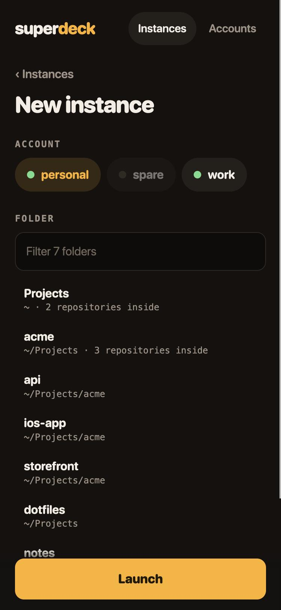
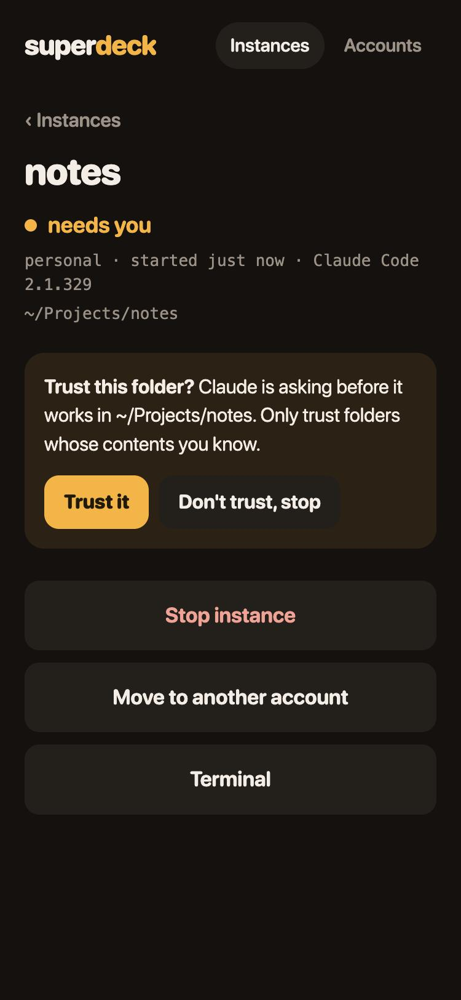
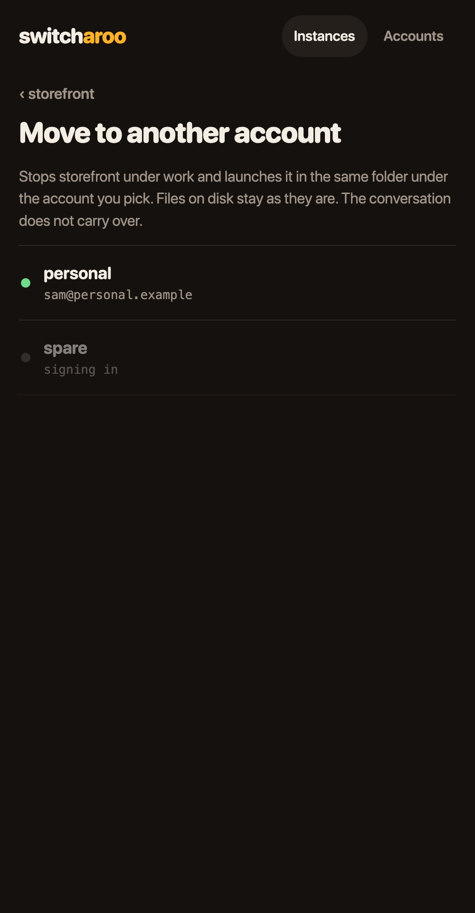

# Superdeck

Start Claude Code Remote Control instances on a Mac from your phone, under more than one Claude account.

Superdeck is a small web application served by one Go binary on your Mac. You open it, see what is running, and launch a new instance by picking an account and a folder. The Mac runs Anthropic's own `claude remote-control` in that folder, and you carry on the conversation in the official Claude app. Superdeck is a launcher and supervisor, not a chat client.

**Status: early.** Signing in accounts, launching a connected instance, running under launchd, and recovering from Superdeck, Claude or a holder being killed have all been run for real on macOS with Claude Code 2.1.296 to 2.1.329. A full session through the Claude app has not been tested end to end. Superdeck has no sign-in of its own and serves plain HTTP; read [Security model](#security-model) before putting it on a network.

<p>
  
  
  
</p>

## What it does

- **Instances.** The home screen lists what is running. Open one to see what it is doing, answer anything Claude is asking, open it in Claude, move it, or stop it.
- **New instance.** Pick an account and a folder: a Git repository, or a folder that holds several. In a repository, sessions started from the Claude app each get their own Git worktree. In a folder of repositories they share the folder.
- **Accounts.** Each account has its own Claude config directory (`CLAUDE_CONFIG_DIR`), so several can be signed in side by side. Adding one runs Anthropic's `claude auth login`: you open Anthropic's page, sign in, and paste the code back. Accounts can be renamed and removed.
- **Questions.** When Claude asks something on first run, such as whether to trust a folder, Superdeck shows the question with buttons. A yes/no question it does not recognise is shown in Claude's own words.
- **Moving.** When one account runs out of usage, move an instance to another: it stops under the first account and launches in the same folder under the second. Files stay; the conversation does not carry over.
- **Staying up.** Claude processes are kept alive by small holder processes, not by Superdeck itself, so instances keep running while Superdeck restarts or is upgraded. An instance that dies on its own is restarted with a growing delay, and instances you launched are brought back after a reboot.
- **Updates.** The home screen shows the installed Claude Code version and a "Check for updates" link that runs `claude update`. Nothing updates on its own. An instance still running an older version offers to relaunch.

<p>
  
  
  
</p>

The screenshots use sample data.

## Run it

```bash
go build -o superdeck .
```

```bash
./superdeck ~/Projects
```

Open `http://127.0.0.1:7433`.

The folders you name are the only places Superdeck may launch Claude in, along with the folders inside them. Name as many as you like, or use glob patterns. Flags go before the folders.

```bash
./superdeck ~/Projects ~/clients/acme-*
```

Nothing else needs installing. Superdeck needs the `claude` CLI and `git` on the Mac.

To reach it from a phone on your LAN or home VPN, listen on the Mac's LAN address:

```bash
./superdeck -addr 192.168.1.20:7433 ~/Projects
```

| Flag | Meaning |
|---|---|
| `-addr` | Address to listen on. Default `127.0.0.1:7433`. |
| `-hosts` | Extra host names the browser may use to reach it, comma separated. Needed when listening on every interface (`0.0.0.0`). Numeric addresses and the Mac's own name are accepted without being listed, so a change of address does not lock you out. |
| `-state` | Where Superdeck keeps its data. Default `~/.superdeck`. |
| `-claude` | Path to the `claude` binary. Default: found on `PATH`. |
| `-launch-agent` | Print a launchd agent for these settings and exit. |

### Start at login

This prints a launchd agent for the settings you pass.

```bash
./superdeck -addr 192.168.1.20:7433 -launch-agent ~/Projects > ~/Library/LaunchAgents/com.github.bradgessler.superdeck.plist
```

```bash
launchctl bootstrap gui/$(id -u) ~/Library/LaunchAgents/com.github.bradgessler.superdeck.plist
```

launchd then restarts Superdeck if it exits. Instances keep running throughout and Superdeck picks them up again. To remove it:

```bash
launchctl bootout gui/$(id -u)/com.github.bradgessler.superdeck
```

### Looking at an instance from the Mac

The Terminal screen in the browser shows what Claude is printing. From a terminal on the Mac you can also attach to the process directly. List what is running, then attach:

```bash
./superdeck attach
```

```bash
./superdeck attach 0123456789ab
```

Detach with `Ctrl-]`. What you type there goes straight to Claude. Pass `-state` if you run Superdeck with a non-default one.

### Upgrading

Replace the binary and restart Superdeck. Instances are not interrupted.

Schema changes are numbered SQL files in `migrations/`, compiled into the binary and applied on startup before anything is launched. Before changing existing data Superdeck writes a copy beside it, named `superdeck.db.schema-N.bak`. If the data was written by a newer Superdeck than the one you are starting, it refuses to run rather than guess.

Holders started by an older Superdeck keep working with a newer one.

## Security model

Superdeck can start processes on your Mac, and **it has no sign-in**. It is built to be reachable only from a network you control, such as your own LAN or a personal VPN. Do not expose it to the internet or to a network other people use.

Be clear about what that means. **Anyone who can reach the page can take control of the Mac through Claude.** They can add an account, sign it in as their own Claude login, launch an instance in one of your folders, answer "yes" to the trust question, and then drive Claude Code on your Mac from their own Claude app. That is, in effect, running commands as you. Restricting what Superdeck itself can run does not prevent this, because each of those steps is something Superdeck is meant to do.

What the restrictions below do buy is that reaching the page gives no shortcut around Claude: there is no way to run an arbitrary command, read a file, or type free text into a process through Superdeck.

- **Fixed commands.** It runs only `claude remote-control`, `claude auth login`, `claude auth status`, `claude auth logout`, `claude update`, `claude --version` and `git init`, with arguments it builds itself and passes as a list, never through a shell. For its own housekeeping it also runs itself (`superdeck hold`, the process that keeps one Claude alive) and `ps` and `pgrep` to check on those.
- **No typing into Claude.** The page cannot send text to a process. It can answer yes or no, or press one of nine named keys (Enter, y, n, 1, 2, 3, Up, Down, Esc). The one exception is a sign-in, which accepts a single code made of letters, digits and `_.~#+/=-`.
- **Validated names.** Account names and new folder names are checked against strict patterns before they reach a command line.
- **Listed folders only.** An instance can be launched only in a folder Superdeck lists: a Git repository, or a folder holding repositories, at or inside a folder you named on the command line, after symlinks are resolved. Hidden folders and the insides of repositories are not offered.
- **Escaped output.** Everything a process prints is HTML-escaped before it is shown. The sign-in button only ever points at an Anthropic address.
- **No cross-site driving.** Every request must carry an expected `Host` header (a name you listed, a numeric address, or the Mac's own name; never a name someone else could point at your Mac) and every state-changing request must be same-origin, so a web page elsewhere cannot drive Superdeck through your browser. Browsers that say where a request came from are refused when it came from another site.
- **Clean environment.** Child processes get an explicit environment. The launcher's own `CLAUDE_*` and `ANTHROPIC_*` variables are not passed on.
- **No shortcuts around Claude's safeguards.** It never passes `--dangerously-skip-permissions` or a permission-mode override, and never edits Claude's config to pre-trust a folder. It never reads or stores Claude credentials.
- **A record.** Every state-changing request is written to the log with its address and the network address it came from. It does not record what was typed.
- **Private files.** Its database, log and sockets are readable only by you.
- **Limits.** At most 16 instances, 3 sign-ins in progress and 12 accounts, and anything that starts a process (launching, moving, signing in, creating a folder) is rate limited.
- **Asking first.** Stopping, moving, relaunching and removing an account all ask for confirmation, with or without htmx.

Not built: sign-in, TLS.

## How it is built

Everything is rendered on the server with Go's `html/template`. The only script in the browser is [htmx](https://htmx.org), one vendored file, which refreshes status and filters the folder list. Every screen also works as plain links and forms.

A few things to know about how it behaves. After Superdeck restarts, instances that had already ended are no longer listed. Renaming an account changes the name shown, not its address or the name a running instance registered with Claude; relaunch the instance to pick up the new name.

Each Claude process is kept alive by a **holder**: the same binary, run as `superdeck hold`, detached from Superdeck. A holder owns the process's pseudo-terminal, keeps the last half megabyte of its raw output, and answers on a private Unix socket. It does nothing clever, on purpose, because Claude lives exactly as long as it does. Superdeck polls each holder, replays the output through a terminal emulator to know what is on the screen, and records each process in its database so that after a restart it knows what is being held.

State lives in `~/.superdeck`:

| Path | What it is |
|---|---|
| `superdeck.db` | SQLite: accounts, the instances to bring back, and the processes being held |
| `accounts/<id>/` | One Claude config directory per account |
| `run/` | Holder sockets. If the state path is very long, a private directory under the system temporary directory is used instead |
| `superdeck.log` | Superdeck's log when started by launchd; otherwise it goes to the terminal |
| `holders.log` | Anything a holder had to say about its own failures |

Go dependencies: [creack/pty](https://github.com/creack/pty) for pseudo-terminals, [hinshun/vt10x](https://github.com/hinshun/vt10x) for terminal emulation, [modernc.org/sqlite](https://modernc.org/sqlite) (SQLite in pure Go, so the binary stays self-contained), [pressly/goose](https://github.com/pressly/goose) for migrations and `golang.org/x/term` for `attach`. No Node, no build step for the front end.

## What happens when things go wrong

| Failure | What Superdeck does |
|---|---|
| Superdeck crashes, is killed or is upgraded | launchd restarts it. Holders and Claude are not touched; Superdeck finds them again and carries on. |
| Superdeck is running but has stopped answering | It checks itself every 30 seconds by asking for a page the way a browser would. After four failures in a row it writes what it was doing to the log and exits, and launchd starts a fresh one. Instances are not touched. |
| The Mac's address on the network changes | The page keeps working at the new address. When listening on every interface, Superdeck answers to any numeric address and to the Mac's own name, on its port. |
| A Claude instance dies on its own | Restarted after 5 seconds, doubling up to every 5 minutes, for as long as it takes. An instance you launched is only ever forgotten by you. The home screen shows it as restarting, and you can tell it not to. |
| A holder dies | Claude dies with it. Superdeck notices after a few seconds, makes sure nothing was left behind, and restarts the instance. It records each Claude process id, so this holds even if Superdeck itself was restarted in between. |
| Superdeck cannot tell whether a holder is alive | It assumes it is. Only a clear "no such process" counts as dead; a check that could not be made never gets a Claude signalled or replaced. |
| One saved record cannot be read at startup | That one is left alone and logged. Superdeck still starts, so the page is there to put it right. |
| A holder is slow, frozen or cut off from its socket | Nothing is signalled, ever, while the holder process is alive. The instance shows "not responding" and recovers by itself if the holder answers again. You can still stop it. |
| The Mac reboots | The instances are gone. Superdeck relaunches the ones you had launched, and keeps trying any that cannot start yet (a disk not mounted, no network). With FileVault on, nothing runs until someone unlocks the Mac in person. |
| An instance that has never once run properly fails | Left stopped and marked failed, with the last thing Claude printed, and forgotten. Once an instance has run for 30 seconds it counts as working and is retried from then on. |
| An account is signed out | The instance stops, says so, and links to the account. It is not retried, since that would only loop, but it is kept: sign the account in and it starts again. For ten minutes after Superdeck starts, a signed-out report is retried three times first, in case the Keychain was not readable yet. |
| Claude asks a question | The instance waits and shows "needs you" until you answer. |
| You decline to trust a folder | The instance stops and is forgotten. |
| A move cannot be completed | The target is checked before anything is stopped. If the new one still fails to start, the old one is put back. Two moves at once, or one from a stale tab, act on the instance as it is now and cannot leave two running. |
| A page is open on an instance that has since been restarted | Its address leads to the current one, and Stop, Move and Relaunch act on the current one. |
| A sign-in code is wrong or expired | The sign-in is marked failed with a "Try again" button. |
| A sign-in is abandoned | Cancelled after 15 minutes. Starting another returns you to the one in progress. |
| A process prints something the terminal emulator cannot handle | That process falls back to plain text. Superdeck keeps running. |
| A second Superdeck is started on the same data | It refuses to start. |
| An upgrade's schema change fails | Superdeck does not start, and the copy made beforehand is kept. |

A conversation that was in progress when Claude itself was killed is lost; Superdeck brings the instance back, not the conversation.

## Open questions

| # | Question | Status |
|---|----------|--------|
| 1 | Can an account be signed in through the page, with the code pasted back? | **Yes.** Done for two accounts. |
| 2 | Do two accounts stay separate? | **Yes for sign-in.** Each gets its own Keychain entry, keyed to its config directory's path. That is why an account's directory never moves. Running two instances at once under different Claude logins is untested. |
| 3 | Does it work when launchd starts it, including Keychain access? | **Yes.** |
| 4 | With a pseudo-terminal, do first-run prompts appear instead of the process exiting? | **Yes.** Folder trust asks `Trust <path>? [y/N]`; after answering, the instance connected with no further prompt. |
| 5 | Do instances survive Superdeck restarting? | **Yes.** Verified by killing Superdeck and checking Claude kept the same process id and stayed connected. |
| 6 | Does each instance show up in the Claude app under the right account only? | **Open.** |
| 7 | After a network outage longer than ten minutes, when the server exits by design, does the restart bring it back cleanly? | **Open.** Restart logic is tested against a stand-in. |
| 8 | Can a conversation continue after its instance is moved to another account? | **Open.** Conversation history is stored on the Mac per account, and the CLI has `--continue`, so it looks possible. Not built. |
| 9 | Does `claude update` behave when run from here? | **Open.** |
| 10 | Is passing a sign-in code through this page within Anthropic's terms for third-party tools? | **Open.** Superdeck hands the code straight to the official binary and stores nothing. Read the [terms](https://code.claude.com/docs/en/legal-and-compliance). |

On Team and Enterprise plans an owner has to turn Remote Control on before any of this works.

Instances run with their account's config directory, not `~/.claude`. Skills, MCP servers and settings you keep in `~/.claude` are not available inside them; what is in the project folder is.

## Development

```bash
go test -race ./...
```

Tests run against a shell-script stand-in for the Claude CLI, so they need no account.

`CLAUDE.md` and the skills in `.claude/skills` hold the working rules for this project: how screens should look, what may run in the browser, Go and supervision conventions, and what has been observed about the Claude CLI. Read them before changing things, whether you are a person or an agent.

htmx 2.0.4 is vendored unmodified in `ui/static/htmx.min.js` under its 0BSD license.

## License

AGPL-3.0. If you change Superdeck and let other people use your version, including over a network, you must share your changes under the same license. See [LICENSE](LICENSE).
